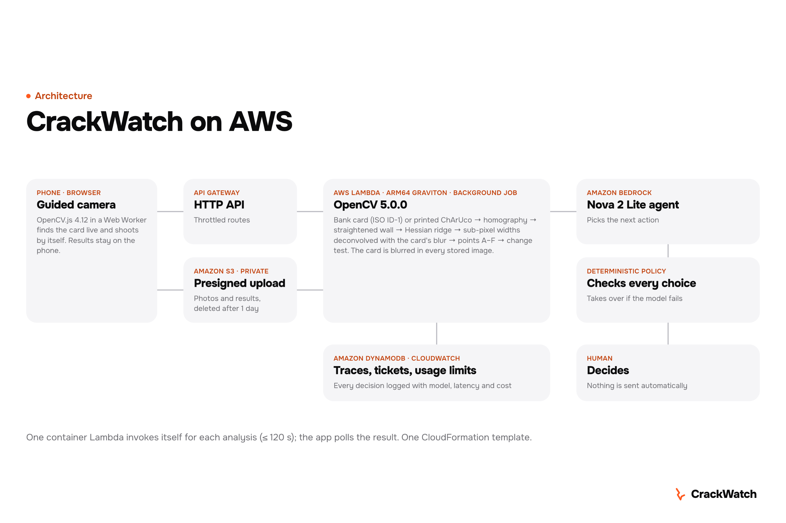

# CrackWatch

A digital crack gauge. A bank-size card held next to a crack (nothing to print), or for monitoring a printed
ChArUco card taped once beside it, turns a phone photo into a **metric, rectified and re-registrable** view of the
wall. OpenCV 5 measures the crack width in millimetres
with an uncertainty and tracks its change between visits. An agent (Amazon Nova 2 Lite on Amazon Bedrock,
validated by a deterministic policy) decides what happens next: a retake, a **closer photo of a precise
region**, a comparison with the previous visit, or a maintenance ticket that **always waits for a human**.

> CrackWatch is a monitoring and triage aid. It is **not** a structural diagnosis and does not replace a
> structural engineer. Thresholds in `crackwatch/agent.py` are configurable defaults, not engineering norms.

Entry for the OpenCV AI Competition 2026 (AWS). Hosted demo: **https://p0k1pglt1e.execute-api.us-east-1.amazonaws.com/**
(see a real example — a concrete-wall crack with the printed card beside it —, follow a synthetic crack over three
months with its known ground truth, or measure your own crack with the guided camera). Source: https://github.com/blanco1er/crackwatch (MIT).



## How it works

| Stage | OpenCV 5.0.0 | Notes |
|---|---|---|
| Capture | Guided live camera: **OpenCV.js 4.12** in a Web Worker on ~640 px frames finds the card, checks size, straightness and stillness, then shoots automatically | It only guides; the measurement is done on the server, on the full photo. Any photo is accepted: decoded with its orientation, brought to 4032 px, EXIF focal read on the device |
| Scale (default) | **Wallet card** (any ISO ID-1 card, 85.60 × 53.98 mm): LSD segments on L, a, b → card-shaped quads → sub-pixel edge points per side, robust line fits, corners = line intersections, exact 4-point homography; card thickness corrected; scale uncertainty by Monte Carlo over the four lines | Nothing to print. Retake reasons when it cannot be trusted (cut, too small, oblique, occluded, not flat). The card is **blurred in every image returned or stored** |
| Scale (precision mode) | Printed ChArUco: `cv2.aruco.CharucoDetector.detectBoard`, `CharucoBoard.matchImagePoints`, `cv2.findHomography(USAC_MAGSAC)` | Board frame in millimetres; A6 card (5×7 squares of 15 mm). Left on the wall, it gives every visit the same frame |
| Quality | Sobel on the card's step edges, saturation outside the card, tilt from the homography | Blur measured **in pixels** (Gaussian σ) on the card itself |
| Rectification | `cv2.warpPerspective` into the card frame | Resolution chosen from the native px/mm |
| Segmentation | 8-bit median background, multi-scale Hessian ridge (`GaussianBlur` + `Sobel`, σ 0.2–3.4 mm), hysteresis with `connectedComponentsWithStats` (weak pixels must also be ≥ 3 % darker than their background), shape filters, Zhang–Suen thinning | `cv2.ximgproc` is contrib-only in OpenCV 5, so thinning is implemented in NumPy |
| Width | Perpendicular profiles (`cv2.remap`, 0.25 px steps), each **deconvolved with the blur measured on the card** (box ⊗ Gaussian model); the local background is read in a 1 mm band on each side of the blurred edges, so a neighbouring dark line cannot narrow the width | Output: median / P90 / sustained max (P95 over 6 mm), 1σ uncertainty, confidence, minimum measurable width, view angle across the crack; summary over a fixed monitoring zone (card sheet + 10 cm, card frame) |
| Main crack | Candidates in the card frame: fragments on opposite sides of the card that continue each other are joined (the crack passes under it); score = closeness to the card × length in the zone × darkness² (an open crack is a dark cavity; joints and stains are surface marks); a line staying within 1 mm of a straight line over 50 mm (joint, wall edge, pipe) is divided by 4 | The user can tap another candidate |
| Stations | 5 points evenly spaced along the chosen crack + its widest point, labelled A–F, fixed in card millimetres; width = median over ±2 mm | At the next visit the new photo is measured **at the same points** (aligned frame), each change tested for significance; a point outside the photo is "not visible", never invented. The points are kept on the device, so a comparison still works after the photos are deleted |
| Change | Same card frame, or ORB + `findHomography(USAC_MAGSAC)` + `findTransformECC` (band-passed) if the card was re-glued | Widening tested on the whole crack **and on each ~10 mm stretch** (z-test with point scatter + each photo's systematic error, Bonferroni 5 % per pair, ≥ 0.1 mm); new length; a segment is "new" only if visit 1 shows no ridge there |
| Decision | Tool use through the Bedrock Converse API; rule policy as validator and fallback | Every step traced (tool, reason, model, latency, tokens, cost) |
| Service | `POST /api/inspect` answers a job id at once; the Lambda runs the inspection asynchronously (up to 120 s); the app polls `GET /api/job/<id>` every second | No photo can hit API Gateway's 29 s limit |


### Why a bank card works as a ruler

Bank cards, national ID cards, driving licences and almost every transport, loyalty or gift card follow one
international standard, **ISO/IEC 7810 ID-1: 85.60 × 53.98 mm, corner radius 3.18 mm, 0.76 mm thick** (tolerances
about ±0.15 %), in every country. Almost everyone already carries a calibrated reference. Business cards are not
standardised (85 × 55 mm in Europe, 88.9 × 50.8 mm in the US, usually square corners) and the shape check refuses
them: on 20 synthetic scenes per format, square-corner business cards were never accepted (0 of 40); a rare
85 × 55 mm card with rounded corners was accepted in 6 of 20 scenes, with a scale up to ~2 % off, which is why the
app asks for a bank, ID, transport or loyalty card.

How `crackwatch/idcard.py` uses it:
- **Sub-pixel edges**: LSD segments propose card-shaped quads; each side is re-measured at full resolution with
  sub-pixel edge points (rounded corners excluded) and a robust line fit; corners are the line intersections.
- **Rounded corners verified**: each 3.18 mm arc must be found where the four lines predict it; with the strict ID-1
  proportions, this separates a real card from other rectangles.
- **Pose with the real focal length**: the 35 mm-equivalent focal is read from EXIF on the device before resizing,
  so proportions are checked for that camera; tilt comes from the homography.
- **Thickness**: the card's face is up to 0.76 mm in front of the wall; the scale is corrected.
- **Fingers**: a finger over an edge is masked (redder than plaster or concrete for every skin tone in our photos,
  thicker than a shadow or a joint); a hidden side can be rebuilt from the other three if the result is still a
  flat ID-1 rectangle; otherwise the app asks for a retake and explains how to hold the card.
- **Uncertainty**: Monte Carlo over the four lines + ISO tolerance + thickness, growing with the distance from the
  card, propagated into every width's uncertainty.
- **Measure first, blur after**: the card's geometry is stored, then its interior is blurred in every image
  returned and in the stored copy; a follow-up reuses the stored geometry, never re-measures a blurred photo.

The printed ChArUco card stays the **precision mode** for monitoring: about 15× smaller scale error on synthetic
scenes, and the same frame at every visit.

The card does four jobs at once: metric scale, rectification, registration between visits, and measurement
of the camera's blur (point-spread function), which is what makes sub-pixel widths possible. The wallet card is
the zero-effort default for a spot check; the printed card, left on the wall, is the reference for monitoring
(about 15× smaller scale error on synthetic scenes, see below).

## Results

All numbers below are produced by scripts in this repository. **Synthetic** and **real** results are kept apart.

### Synthetic (held-out set: seeds 20000+, never used for tuning; 300 single photos, 40 two-visit pairs)

Procedural concrete, cracks of 0.2–5 mm, 3–9 px/mm, tilt 0–45°, blur, JPEG, glare, motion blur, stains and joints.
Full tables and the list of all 69 failure cases: [`eval/RESULTS.md`](eval/RESULTS.md). Numbers before the 23 Oct measurement fixes in brackets.

| Metric (E1) | Value |
|---|---|
| Card detected | 299/300 (99.7 %) |
| Crack detected (≥ 10 matched points) | 258/300 (86.0 %) [259] |
| Point-wise width MAE | **0.15 mm** (median absolute error 0.07 mm) [0.21 / 0.10] |
| Same, pixel-level distance-transform baseline | 0.39 mm |
| Per-image median-width MAE | **0.12 mm** [0.17] |
| Per-image sustained max-width MAE | 0.26 mm (bias +0.13 mm: over-estimation) [0.37, +0.27] |
| Announced uncertainty covers the error (≤ 2σ) | 83 % of images (still under-estimated) [71 %] |

| Metric (E4, two visits) | Value |
|---|---|
| Registration error, card left in place / card re-glued | 0.00 / 0.04 mm (median) |
| Widening MAE (true widening 0–1 mm) | **0.08 mm** [0.07] |
| Change alert precision / recall; false alerts on unchanged pairs | 1.00 / 0.80; 0/8 [1.00 / 0.94]. Widening flagged: 0.1 mm 60 %, 0.2 mm 50 %, ≥ 0.3 mm 100 % [100 / 83 / 100 %]: the old test was over-confident (fixed 0.04 mm floor); the new one is calibrated (`scripts/calib_sys.py`, synthetic pairs outside the test set) |

On the tuning set (seeds 1000–1299) the median-width MAE was 0.10 mm and the max-width MAE 0.27 mm (before the
23 Oct fixes): the generalisation gap is reported, not hidden. The 23 Oct changes were made for physical reasons
found on the real photos, checked on this held-out set, and no threshold was re-tuned.

### Real photos

All taken by us on real walls with an ordinary phone (iPhone HEIC, measured at 4032 px like the service), no ground truth except the printed chart.
Full tables: [`eval_real/RESULTS.md`](eval_real/RESULTS.md) (`scripts/process_real.py`) and
[`eval_real_carte/RESULTS-deux-cartes.md`](eval_real_carte/RESULTS-deux-cartes.md) (`scripts/eval_idcard_twocards.py`).

| Test | Result |
|---|---|
| **E2** printed chart, bars of known width 0.2–3 mm (v1: 4 photos, v2: 8 photos) | Mean absolute error **0.061 mm** (v1, 32 bar measurements) and **0.075 mm** (v2, 61). Smallest bar found on ≥ 80 % of photos: **0.20 mm**. Thin bars read wide (0.2 mm → +0.10 mm on v1, 0.3 mm → +0.06); one v2 bar printed at 0.7 mm reads 0.61 mm on all 8 photos while its 0.7 mm neighbour reads 0.72 (print not checked with a scanner) |
| **E4** two "visits" of the chart (v1 → v2: 3 bars widened by 0.2 / 0.5 / 0.5 mm, 2 lengthened by 10 mm) | Width change per bar: mean error **0.027 mm**. Photo pairs flagged "significant widening": **4/4**; lengthening detected 4/4. Per ~10 mm stretch: widened bars flagged in 8 of 12 comparisons (the 0.5 mm ones in 7 of 8, the 0.2 mm one in 1 of 4), unchanged bars wrongly flagged in 1 of 17 |
| **E3** repeatability, concrete wall, card next to the crack (5 photos, printed card as reference) | Coefficient of variation of the width across photos: **2.9 %** (monitoring zone), **3.0 %** on the same 10 mm stretches; 0.7 % over the 3 photos taken within 10° of square. 2 more photos with the printed card only: 4.89 and 4.78 mm |
| **E3** rendered facade, card next to the crack (8 + 4 photos) | 14.8 % and 30.0 % (zone), 15.0 % and 6.7 % on the same stretches |
| **E3** card taped ON the crack (crack A: 5 photos, crack B: 7) | 15.7 % and 17.8 % (zone), 17.3 % and 16.7 % on the same stretches |
| **Wallet card vs printed card**, both in the same 13 photos | Width at the same crack points, wallet / printed: median **−1.7 %**, from −3.1 % to +1.3 %; inside the announced ±2σ scale uncertainty in **12/13**; bank card accepted in 13/13 |

Why the facade numbers are worse: these cracks are deep and irregular (chipped lips, debris), so the *apparent*
width depends on the viewing angle (crack A: 4.0–4.1 mm within 6.5° of square, 2.8–3.7 mm at 14–20°), and on the
render the segmentation merges the horizontal mortar joints into the crack. On the clean concrete crack the same
pipeline repeats within 3 %. The wallet card's rectified window differs from the printed card's, so the two
"main crack" medians are not comparable (+21 % median); only the same-points comparison above is. On synthetic scenes
the wallet card's scale error at the crack is 0.60 % median, 2.49 % P90 (119 accepted of 200 scenes), against
0.04 % for the printed card ([`eval_idcard/RESULTS-carte.md`](eval_idcard/RESULTS-carte.md)): use the wallet card
for a spot check, the printed card for monitoring.

Measurement fixes of 23 Oct 2026, each found on the real photos and explainable in one sentence:
- **Wide widths were under-estimated** (2.0 mm bar read 1.83 mm, 3.0 mm bar often lost): each profile's background
  was read at the far ends of the profile, which reached the next bar. It is now read just outside the crack's
  blurred edges. Ridge scales go up to 3.4 mm and darkness tests use the brighter of a 12 mm and a 24 mm median,
  so cracks up to ~10 mm keep a centred skeleton (`tests/test_wide.py`: 1–8 mm bars within 0.03 mm).
- **The 0.2 mm bar was never detected** because the chart's board mask plus its 4 mm margin covered it, not
  because of resolution.
- **Local widening was invisible**: significance was tested on the median of the whole crack network. It is now
  tested on the whole crack and on each ~10 mm stretch, with a calibrated uncertainty.
- **Repeatability on real cracks** depends mostly on the viewing angle across the crack (a deep crack's lip hides
  part of it): on crack A, photos within 6° of square read 4.1–4.3 mm, photos at 13–22° read 2.8–3.3 mm. The
  view angle is now reported for every crack; an agent rule to request a square retake exists but is off by
  default (its 10° threshold has not been validated on independent photos).

### Failure cases (shown, not hidden)

- A thin crack over a dark stain, or a crack folding back on itself: width over-estimated.
- Cracks under ~2 px wide in the photo are often missed: the agent asks for a closer photo instead of
  reporting a number.
- Long straight dark lines (tile joints) are filtered by shape and can hide a real straight crack.
- The homography assumes a planar wall around the card; curved surfaces are out of scope.
- A single photo measures the *apparent* width: for a deep crack seen at an angle, one lip hides part of it.
- Any long dark line (wall edge, mortar joint) near the card enters the monitoring zone; the zone fixes *where*
  the width is read, not *what* is read. On a rendered facade the segmentation can merge the crack with the
  mortar joints it touches; the main-crack choice then includes them.
- One photo per visit cannot reliably show widening below ~0.3 mm (calibrated per-photo systematic error).
- An experimental spur-pruning step (`SegParams.prune_short_mm`, off by default) improved the max-width error
  on the tuning set (0.266 → 0.251 mm) but lowered crack coverage (0.85 → 0.75), so it was not adopted.

## Hosted demo and AWS

- **One container Lambda, arm64 (Graviton)**, Python 3.12, `opencv-python-headless==5.0.0.93`, 3008 MB, behind an
  **API Gateway HTTP API** with throttled routes. It serves the page and runs measurement + agent loop.
- **Amazon S3** (private, SSE, TLS only): photos are uploaded with a 5-minute presigned POST (JPEG, ≤ 15 MB; the app
  brings any photo to 4032 px first) and **deleted after 1 day**. Decoding drops EXIF and GPS. A photo showing a bank
  card is replaced in storage by its redacted copy.
- **Asynchronous inspections**: the HTTP request stores the job and answers at once; the function invokes itself
  asynchronously (`lambda:InvokeFunction` on itself, timeout 120 s, no retry) and writes the result JSON next to the
  uploads (same 1-day expiry); the app polls it.
- **Amazon Bedrock**: `us.amazon.nova-2-lite-v1:0` through the Converse API with 5 tools. On-demand price read from
  the AWS Price List API on 19 Oct 2026: $0.33 / $2.75 per million input / output tokens in us-east-1, i.e.
  about $0.0015 per decision.
- **DynamoDB**: traces, tickets, usage counters and the anonymous visit log (TTL). **CloudWatch**: JSON logs, 14 days.
- **Cost guards**: route throttling, inspections per day (global and per anonymous visitor), LLM calls per day
  (beyond it, the rules decide alone), 15 MB upload limit, 120 s per inspection. Data resources are retained if the stack is deleted.
- **Least privilege**: the function role can read/write/delete `uploads/*` in its bucket, four DynamoDB actions on its
  table, invoke itself, and `bedrock:InvokeModel` on one model. No key or secret is stored in the image or in this repository.
- **Privacy**: visits are logged anonymously (salted hash of IP + browser; the IP itself is never stored) so the author
  knows whether the demo was tried. No photo content, file name or personal data is logged.

## Reproduce

```bash
python3 -m venv .venv && .venv/bin/pip install -r requirements-dev.txt
.venv/bin/python tests/test_agent.py && .venv/bin/python tests/test_api.py      # fast tests
.venv/bin/python scripts/cw.py cards --out print                                 # printable cards + test charts
.venv/bin/python scripts/make_synth.py --out data/synth_test --n 300 --pairs 40 --seed0 20000
.venv/bin/python scripts/run_eval.py --data data/synth_test --out eval           # E1 + E4 -> eval/RESULTS.md
.venv/bin/python scripts/cw.py agent photo.jpg --previous older.jpg              # one inspection, rules only
.venv/bin/python scripts/serve_local.py --port 8765                              # the demo page, locally, rules only
AWS_PROFILE=<profile> .venv/bin/python scripts/serve_local.py --bedrock         # ... with Nova 2 Lite as planner
.venv/bin/python scripts/serve_local.py --jobs                                   # ... with AWS-like async jobs
.venv/bin/python scripts/process_real.py --dir <photos> --out eval_real          # real-photo evaluation
.venv/bin/python scripts/eval_idcard_twocards.py --dir <photos>/v2-carte-a-cote --out eval_real_carte
```

Deploy (us-east-1, your own credentials; needs the AWS CLI and `crane`, not Docker):

```bash
AWS_PROFILE=<profile> deploy/deploy.sh
```

`deploy/build_image.py` installs the linux/aarch64 wheels with `pip --platform`, packs one reproducible layer and
appends it with `crane` to the official `public.ecr.aws/lambda/python:3.12-arm64` image, pinned by digest.
`deploy/Dockerfile` builds the same image with Docker. `deploy/template.yaml` is a CloudFormation template using the
SAM transform, deployed with plain `aws cloudformation deploy`.

Print the cards from `print/*.pdf` at **100 % / actual size** and check the printed 50 mm ruler with a real ruler.

## Layout

| Path | Content |
|---|---|
| `crackwatch/card.py`, `printio.py` | ChArUco card specs, print-exact PNG/PDF, E2/E4 test charts |
| `crackwatch/measure.py` | measurement pipeline |
| `crackwatch/idcard.py`, `synth_idcard.py`, `exif.py` | wallet-card reference (ID-1), its synthetic evaluation, EXIF focal |
| `crackwatch/selection.py`, `stations.py` | main-crack choice, fixed measurement stations |
| `crackwatch/change.py` | two-visit registration and change |
| `crackwatch/agent.py` | rule policy, Nova (Converse) planner, guard-rails, agent loop and trace |
| `crackwatch/service.py`, `api.py`, `store.py`, `visits.py` | hosted demo: inspection service, routes, storage, anonymous visits |
| `crackwatch/synth.py`, `evaluate.py`, `scripts/run_eval.py`, `eval_e4.py` | synthetic generator and evaluation |
| `scripts/process_real.py` | real-photo evaluation (E2, E4 real, E3) |
| `scripts/make_demo_samples.py` | the 4 demo photos: a synthetic crack (exact ground truth, shown in the UI) on a real CC0 wall texture (`crackwatch/assets/textures/ATTRIBUTION.md`) |
| `web/` | the app (no framework, no third-party request): tracked cracks stored on the device, crack history with aligned before/after, live analysis, inspector card and trace, human ticket review, PDF report, calendar reminder, share link, EN/FR, light/dark |
| `deploy/` | Lambda handler, image build without Docker, Dockerfile, CloudFormation template, deploy script |
| `tests/` | agent scenarios, API and async jobs, cost guards, visits, planner fallback, wallet card and redaction, wide widths, main-crack choice, stations, fast paths |

The four simulation photos are one illustrative wall chosen among six generated walls; the aggregate numbers above
are the honest measure of accuracy, and the demo page shows each photo's ground truth next to the measurement. The
real example (`web/samples/real.jpg`, concrete wall, 24 Oct 2026) is our photo IMG_1640, downscaled and
re-encoded without any metadata.

## License

MIT — see `LICENSE`. Author: Blanco (@blanco_1er).
