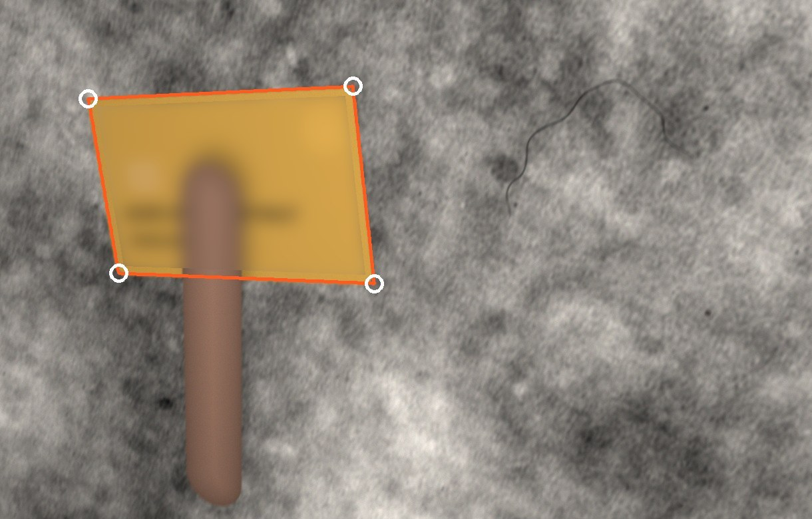
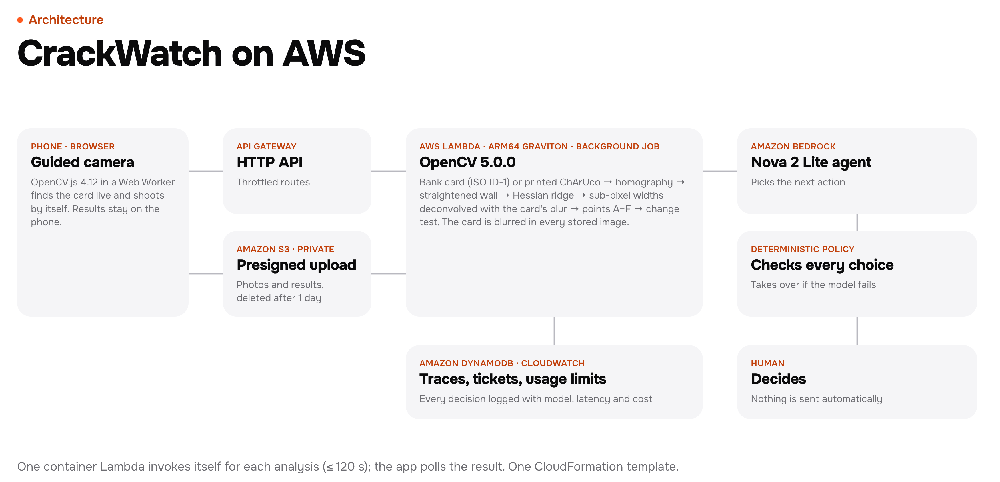
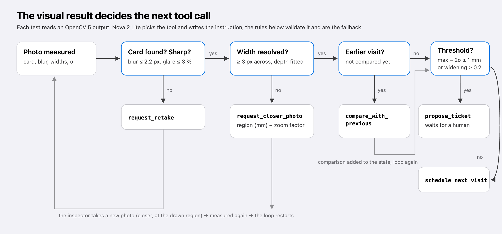
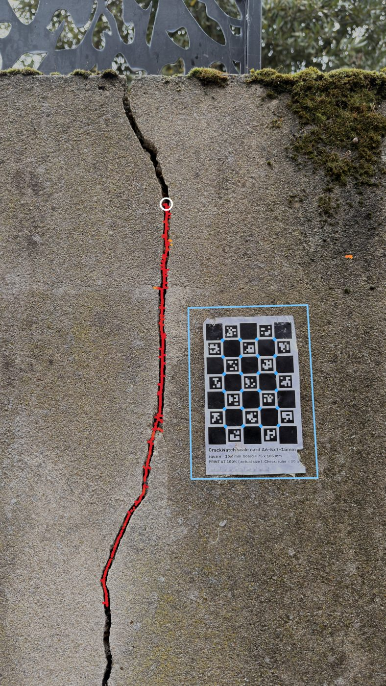
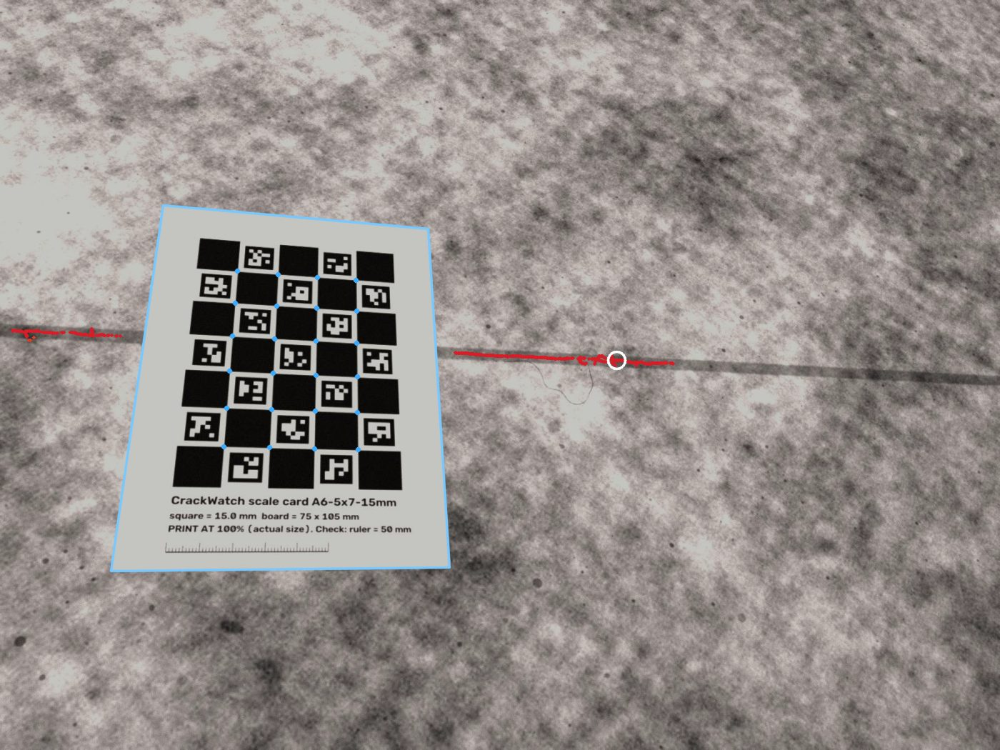
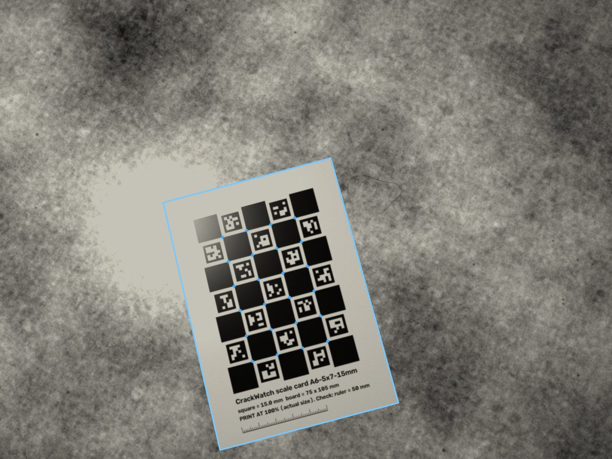
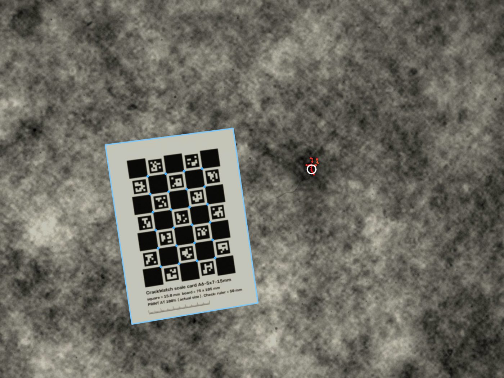
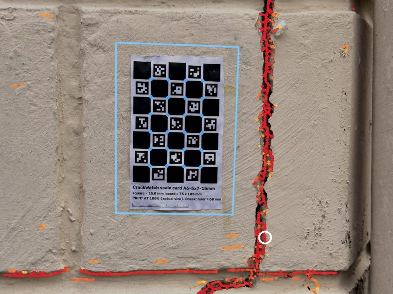

# CrackWatch — Technical report

**Measure a wall crack in millimetres with a phone and a card from your wallet, and know whether it is growing.**

OpenCV AI Competition 2026 · Team: Blanco, solo builder · Demo: https://p0k1pglt1e.execute-api.us-east-1.amazonaws.com/ · Code: https://github.com/blanco1er/crackwatch (MIT) · Report of 24 October 2026

Every number in this report comes from a script and a results file in the repository: `eval_real/RESULTS.md`, `eval_real_carte/RESULTS-deux-cartes.md`, `eval_idcard/RESULTS-carte.md`, `eval/RESULTS.md` and the tests in `tests/`. Real and synthetic results are always reported separately. **Every real photo in this report, the demo and the evaluation was taken by us on real walls with an ordinary phone (an iPhone).**

## 1. Problem and users

You notice a crack in a wall. Was it there last year? Is it getting wider? Nobody can answer from memory, and a phone photo has no scale, so two photos taken months apart cannot be compared. Today the options are a plastic tell-tale gauge glued across the crack and read by eye, or a paid visit from an expert. So people either panic or ignore it, and both can be expensive.

The question that matters is simple and measurable: **is it growing, and by how much?** CrackWatch answers it with a phone:

- **Homeowners and tenants**: should I worry? A width in millimetres, and a change since the last visit, tested against the measurement noise.
- **Property managers**: many cracks across many buildings, each with fixed measurement points and a dated history.
- **Insurers**: dated, reproducible evidence with its uncertainty.
- **Surveyors and engineers**: fixed points and a history before they visit, delivered as a PDF report.

CrackWatch is a **monitoring and triage aid, not a structural diagnosis**. Thresholds are configurable defaults, not engineering norms, and a human approves every report that is sent.

**Existing approaches.** Physical tell-tale gauges are precise at one point but must be glued, then read and logged by hand. Crack-width comparator cards are read by eye and give no history. Generic phone measuring apps (AR rulers) work at centimetre scale, not tenths of a millimetre. Most crack-detection research focuses on segmentation (where is the crack) rather than calibrated width and its change over time. CrackWatch is a digital crack gauge: a metric reference in every photo, fixed measurement points, and a statistical test for change.

## 2. Why a bank card

Bank cards, national ID cards, driving licences and almost every transport, loyalty or gift card follow one international standard, **ISO/IEC 7810 ID-1: 85.60 × 53.98 mm, corner radius 3.18 mm, 0.76 mm thick**, with tolerances of about ±0.15 %, in every country. Almost everyone already carries a calibrated reference, so nothing has to be printed or bought.

Business cards are **not** standardised (85 × 55 mm in Europe, 88.9 × 50.8 mm in the US, usually with square corners). On 20 synthetic scenes per format, square-corner business cards of both sizes were never accepted (0 of 40). A rare 85 × 55 mm card with rounded corners was accepted in 6 of 20 scenes, with a scale up to about 2 % off. That is why the app asks for a bank, ID, transport or loyalty card.



How `crackwatch/idcard.py` uses the card:

1. **Candidates.** `cv2.createLineSegmentDetector` on the L, a and b channels; pairs of near-parallel segments form card-shaped quadrilaterals whose rectified aspect ratio is close to 85.60 / 53.98 for a plausible focal length.
2. **Sub-pixel edges.** Along each side, at full resolution and excluding the rounded corners, colour-edge points are located to a fraction of a pixel and fitted with a robust line. Points are capped at 2 px from the line, so card chips, wall grain or a finger outline cannot bend it. The corners are the intersections of the four lines, which gives an exact homography to the 85.60 × 53.98 mm rectangle.
3. **Rounded corners verified.** Each 3.18 mm arc must be found where the four lines predict it. Weak corners combined with proportions more than 1 % off are refused: the outline is then probably the card plus something next to it.
4. **Pose with the real focal length.** The 35 mm-equivalent focal length is read from EXIF on the phone, before the photo is resized. Proportions are checked for that exact camera, and the tilt comes from the homography.
5. **Thickness.** The card's face is up to 0.76 mm in front of the wall; the scale is corrected for that offset.
6. **Fingers.** A finger or hand over an edge is masked: in our photos it is redder than plaster or concrete for every skin tone (CIE a\*), and thicker than a shadow or a joint. Its edge points are discarded. A side hidden under a finger can be rebuilt from the other three, but only if the result is still a flat ID-1 rectangle. Otherwise the user gets a precise retake instruction (`card_occluded`, `card_not_flat`, `card_too_oblique`, …).
7. **Uncertainty.** A Monte Carlo over the four fitted lines, plus the ISO size tolerance and the thickness term, gives a scale uncertainty that grows with the distance from the card. It is propagated into every width's uncertainty.
8. **Blur.** The card's high-contrast edges give the blur of this exact photo in pixels. On synthetic scenes the estimated blur has a 0.19 px mean absolute error.
9. **Privacy: measure first, blur after.** The card's geometry is stored, then its interior (minus a 2.5 mm edge band) is blurred in every image returned and in the stored copy. A follow-up reuses the stored geometry; a blurred photo is never measured again. Only an *accepted* card is blurred, never a rejected candidate.

**Precision mode.** A printed ChArUco card (A6, 5 × 7 squares of 15 mm, free PDF in the app) taped once beside the crack gives a ~15× smaller scale error on synthetic scenes (0.04 % vs 0.60 % median) and the exact same frame at every visit. Rule of use: the bank card for a quick check, the printed card left on the wall for monitoring.

## 3. System architecture



1. **Phone or browser.** The app has no framework and makes no third-party request except the pinned OpenCV.js file. A live guide (OpenCV.js 4.12 in a Web Worker, ~640 px preview frames) finds the card, asks to come closer, hold straight and still, and shoots. Any photo is accepted: decoded with its orientation, brought to 4032 px, its EXIF focal length read on the device first. 48 MP photos are accepted, with a 60 MB hard cap.
2. **Upload.** A 5-minute presigned POST into a private S3 bucket (SSE, TLS only), deleted after one day.
3. **Inspection job.** `POST /api/inspect` stores a job and answers at once with its id. The Lambda invokes itself asynchronously (120 s limit, no retry) and writes the result next to the uploads. The app polls `GET /api/job/<id>` every second. No photo can hit API Gateway's 29 s limit.
4. **Measurement** (OpenCV 5, §4) and **agent loop** (§5) run in the same function.
5. **State.** DynamoDB holds traces, tickets, usage counters, upload metadata (focal length, card geometry) and an anonymous visit log. CloudWatch keeps JSON logs for 14 days.

The tracked cracks, their measurement points and their history are kept on the device, so a comparison still works after the server has deleted the photos.

## 4. OpenCV 5 pipeline

`opencv-python-headless 5.0.0.93`, classic computer vision, no learned model. The file is `crackwatch/measure.py` unless noted otherwise.

| Stage | OpenCV 5 | Choices and parameters |
|---|---|---|
| Reference | `cv2.aruco.CharucoDetector.detectBoard`, `CharucoBoard.matchImagePoints`, `cv2.findHomography(USAC_MAGSAC)` + least-squares polish; or the ID-1 card (§2) | Frame in millimetres. "Auto" mode: printed card if present, else a wallet card |
| Quality | `Sobel` on the card's step edges; saturation outside the card | Blur σ in pixels; limits 2.2 px blur, 3 % saturated, 55° tilt |
| Rectification | `cv2.warpPerspective` into the card frame | Resolution chosen from the native px/mm |
| Segmentation | 8-bit median background, multi-scale Hessian ridge from `GaussianBlur` + `Sobel` (σ 0.2–3.4 mm), hysteresis with `connectedComponentsWithStats`, shape filters | Weak pixels must also be ≥ 3 % darker than their background; darkness tests use the brighter of a 12 mm and a 24 mm median, so cracks up to ~10 mm keep a centred skeleton |
| Skeleton | Zhang–Suen thinning in NumPy | `ximgproc` is contrib-only in OpenCV 5 |
| Width | Perpendicular profiles with `cv2.remap` (0.25 px steps), each **deconvolved with the blur measured on the card** (box ⊗ Gaussian model) | Resolved: full width at half maximum; unresolved: darkness integral / the crack's own depth. Background read in a 1 mm band just outside the blurred edges. Output: median, P90, sustained maximum (P95 over 6 mm), 1σ uncertainty, confidence, view angle across the crack |
| Main crack (`selection.py`) | Scoring in the card frame | Fragments on opposite sides of the card that continue each other are joined (the crack passes under it). Score = closeness to the card × length in a 10 cm zone × darkness²; a line within 1 mm of straight over 50 mm (joint, wall edge, pipe) is divided by 4. The user can tap another candidate |
| Points (`stations.py`) | — | 5 evenly spaced points + the widest, labelled A–F, fixed in card millimetres; width = median over ±2 mm; u = hypot(1.4826·MAD, systematic) |
| Change (`change.py`) | Same card frame, or ORB + `findHomography(USAC_MAGSAC)` + `findTransformECC` on a band-passed image if the card moved | z-tests on the whole crack, on each ~10 mm stretch and at each point, with a calibrated per-photo systematic error, Bonferroni 5 % per pair, ≥ 0.1 mm |

Three findings shaped the pipeline:

- **Measure the point-spread function on a known target.** Deconvolving each profile with the blur measured on the card more than halves the pixel-level baseline's error (0.15 vs 0.39 mm, synthetic held-out set).
- **Read the background next to the crack, not at the profile ends.** The old method read a 2.0 mm bar as 1.83 mm, because the far ends of the profile reached the next bar. `tests/test_wide.py` now checks 1–8 mm bars within 0.03 mm.
- **A crack is a cavity, a joint is a surface mark.** The darkness² term and the straightness penalty pick the crack among the dark lines of the wall. On one real series (card taped on the crack), the right crack went from 3 of 7 photos to 7 of 7.

## 5. The agent

The agent decides what to do next from the OpenCV output. It is not a chatbot commenting on a fixed result: the **visual result changes the tool call**.



- **Tools**: `request_retake`, `request_closer_photo` (with a region in card millimetres and a zoom factor: active perception), `compare_with_previous`, `propose_ticket`, `schedule_next_visit`.
- **Planner**: Amazon Nova 2 Lite (`us.amazon.nova-2-lite-v1:0`) through the Bedrock Converse API with tool use, temperature 0. The rule policy's suggestion and the measured observation are in the prompt.
- **Guard-rails** (`validate_action`). A tool call is accepted only if the measured precondition that justifies it holds:
    - a closer photo only if the crack is unresolved (fewer than 3 px across, assumed depth, or low confidence) or no crack was found on a far photo;
    - a retake only if the photo is unusable;
    - a comparison is mandatory when a previous visit exists and has not been compared;
    - a ticket justified by a threshold cannot be dropped;
    - an overridden proposal stays in the trace with the reason (`llm_proposed`, `override_reason`).
- **Fallback.** If the model fails, refuses, or the daily budget (250 calls by default) is used up, the rules decide alone, and the trace says so.
- **Human approval.** A ticket is only *proposed* (`pending_human_approval`). In the app, **Alert a professional → Prepare the report** approves it and produces the PDF; **Not now** leaves it. Nothing is sent automatically.
- **Observability.** Every step is traced (tool, reason, planner, latency, tokens, cost) and shown under **How it was measured**.

**A trace where the image changes the plan.** This is the demo's 3-month simulation, re-run on 24 Oct with the rule policy. It uses a synthetic crack of known width drawn on a real CC0 plaster texture.

| Photo | OpenCV 5 measures | Action |
|---|---|---|
| Blurred | card-edge blur 3.1 px > 2.2 px | `request_retake` |
| Sharp, far | crack too thin for 3.8 px/mm | `request_closer_photo`, 2.1× closer, region in card mm |
| Close | sustained max 0.56 ± 0.06 mm (2σ; truth 0.57), median 0.34 mm (truth 0.35) | `schedule_next_visit` |
| 3 months later | median grew by 0.46 mm (truth 0.42), max 1.00 mm (truth 1.02) | `compare_with_previous` → `propose_ticket`, pending human approval |

The traced length is over-estimated (101 mm for 70 mm, then 143 mm for 82 mm).

**A real bug, fixed.** On real follow-ups, Nova once asked for a closer photo of a crack about 6 mm wide, after the comparison had been made. The precondition gating above was the fix. `tests/test_agent_guard.py` replays the observations recorded from two real follow-ups (`tests/fixtures/followup_*.json`) with a mocked model that always asks for a closer photo. The trace must still be *compare → ticket*, with the model's proposal logged as overridden.

## 6. AWS deployment and reproducibility

- **Compute**: one container-image Lambda, **arm64 (Graviton)**, Python 3.12, 3008 MB, behind an API Gateway HTTP API. Throttling: 10 req/s (burst 20) by default, 3 req/s (burst 6) on POST routes.
- **Build without Docker**: `deploy/build_image.py` installs the linux/aarch64 wheels with `pip --platform manylinux_2_28_aarch64`, packs one reproducible layer and appends it with `crane` to the official `public.ecr.aws/lambda/python:3.12-arm64` image, pinned by digest. `deploy/Dockerfile` builds the same image with Docker.
- **Infrastructure as code**: `deploy/template.yaml` (CloudFormation with the SAM transform), deployed with `deploy/deploy.sh` (plain `aws cloudformation deploy`). Data resources are retained if the stack is deleted.
- **Least privilege**: the role can read, write and delete `uploads/*` in its bucket, use four DynamoDB actions on its table, invoke itself, and call `bedrock:InvokeModel` on one model. No key or secret is stored in the image or the repository; the visitor-hash salt is generated at deploy time.
- **Cost guards**: route throttling; 1500 inspections per day and 80 per anonymous visitor; 250 LLM calls per day (beyond that, rules only); a 15 MB upload limit; 120 s per inspection.
- **Live guide integrity**: OpenCV.js 4.12.0 is fetched from a pinned jsDelivr URL, checked against its SHA-256 with `crypto.subtle` before it runs, and served from the same origin if the CDN fails. The worker's content security policy adds only that CDN origin.

```bash
python3 -m venv .venv && .venv/bin/pip install -r requirements-dev.txt
.venv/bin/python tests/test_agent.py && .venv/bin/python tests/test_api.py      # fast tests
.venv/bin/python scripts/cw.py cards --out print                                 # printable cards + test charts
.venv/bin/python scripts/make_synth.py --out data/synth_test --n 300 --pairs 40 --seed0 20000
.venv/bin/python scripts/run_eval.py --data data/synth_test --out eval           # E1 + E4
.venv/bin/python scripts/eval_idcard.py                                          # wallet card, synthetic
.venv/bin/python scripts/process_real.py --dir <photos> --out eval_real          # real photos (E2, E4, E3)
.venv/bin/python scripts/eval_idcard_twocards.py --dir <photos>/v2-carte-a-cote --out eval_real_carte
.venv/bin/python scripts/serve_local.py --port 8765 --jobs                       # the demo, locally
AWS_PROFILE=<profile> deploy/deploy.sh                                           # deploy (us-east-1)
```

## 7. Evaluation

### 7.1 Real photos (taken by us on real walls)

The measurement tables use 43 photos; 10 more bank-card-only photos are used for the detector tests. Photos are measured at 4032 px, like the service. Only the printed chart has a ground truth.

| Test | Result |
|---|---|
| **E2** printed chart, bars of known width 0.2–3 mm (v1: 4 photos, v2: 8) | Mean absolute error **0.061 mm** (v1, 32 bar measurements) and **0.075 mm** (v2, 61). Smallest bar found on ≥ 80 % of photos: **0.20 mm**. Thin bars read wide (0.2 mm → +0.10 mm on v1) |
| **E4** two "visits" of the chart (3 bars widened by 0.2 / 0.5 / 0.5 mm) | Width-change error **0.027 mm**. Significant widening flagged in **4/4** photo pairs; lengthening detected 4/4. Per ~10 mm stretch: widened bars flagged in 8 of 12 comparisons, unchanged bars wrongly flagged in 1 of 17 |
| **Bank card vs printed card**, both in the same 13 photos | Bank card accepted in 13/13. Width at the same crack points: **−3.1 % to +1.3 %** (median −1.7 %); 12/13 inside the announced ±2σ scale uncertainty |
| **Bank-card decision under JPEG re-compression** (15 photos, quality 80–100) | Same accept/refuse decision at every quality; scale within 0.5 %. On 6 photos showing only the printed card, no pixel is blurred |
| **E3** repeatability, concrete wall, card next to the crack (5 photos) | Coefficient of variation of the width across photos: **2.9 %** (monitoring zone), 3.0 % on the same 10 mm stretches, 0.7 % over the 3 photos taken within 10° of square |
| **E3** rendered facade, card next to the crack (8 + 4 photos) | 14.8 % and 30.0 % (zone); 15.0 % and 6.7 % on the same stretches |
| **E3** card taped *on* the crack (crack A: 5 photos, crack B: 7) | 15.7 % and 17.8 % (zone); 17.3 % and 16.7 % on the same stretches |



**Why the facade numbers are worse.** These cracks are deep and chipped. Their *apparent* width depends on the viewing angle (crack A: 4.0–4.1 mm within 6.5° of square, 2.8–3.7 mm at 14–20°), and on the render the segmentation merges the mortar joints it touches. On the clean concrete crack the same pipeline repeats within 3 %. The angle across the crack is now reported with every measurement. An agent rule that requests a square retake exists, but it is off by default because its 10° threshold has not been validated on independent photos.

### 7.2 Synthetic, held-out

300 photos and 40 two-visit pairs from seeds 20000+, never used for tuning. The scenes have procedural concrete, cracks of 0.2–5 mm, 3–9 px/mm, tilt 0–45°, blur, JPEG, glare, motion blur, stains and joints.

| Metric | Value |
|---|---|
| Card detected / crack detected | 299/300 / 258/300 (27 of the 41 misses are cracks under 0.5 mm) |
| Point-wise width MAE | **0.15 mm** (pixel-level distance-transform baseline: 0.39 mm) |
| Per-image median-width MAE | **0.12 mm** |
| Per-image sustained max-width MAE | 0.26 mm, bias +0.13 mm (over-estimation) |
| Uncertainty covers the error (≤ 2σ) | 83 % of images (still under-estimated) |
| Median relative error vs width in photo pixels | 56 % below 1 px, 35 % at 1–2 px, 15 % at 2–4 px, 5 % at 4–8 px, 2.6 % above 8 px |
| Registration error, card in place / card re-glued | 0.00 / 0.04 mm (median) |
| Widening MAE between two visits | **0.08 mm** |
| Change alert precision / recall; false alerts | 1.00 / 0.80; 0 on 8 unchanged pairs. A 0.1–0.2 mm widening is flagged in about half the pairs, ≥ 0.3 mm in all |
| **Bank card**, scale error at the crack (200 scenes, seeds 50000+) | 0.60 % median, 2.49 % P90; 119/200 accepted (70 % inside the announced domain); printed card on the same scenes 0.04 % |

On the tuning set (seeds 1000–1299) the median-width MAE was 0.10 mm. The generalisation gap is reported, not hidden. Synthetic numbers are optimistic: flat wall, procedural concrete, uniform crack depth.

### 7.3 Agent and software tests

- 17 scripted policy scenarios: no card, glare, blur, oblique, retake budget, view angle with the rule off, thin crack, prior-based depth, far and close photos with no crack, history, stable, growth, local widening, wide crack, near-threshold with uncertainty, step budget.
- A full loop: *closer photo → compare → ticket pending approval*.
- The Nova planner's fallback and guard-rails, and the determinism test of §5.
- Eleven test files in `tests/` in total, also covering the API and async jobs, cost guards, wallet-card detection and redaction, JPEG stability, wide widths, the main-crack choice, the measurement points, and the fast paths (identical results).

## 8. Failure cases

Failure cases are shown, not hidden.

| | |
|---|---|
|  |  |
|  |  |

- **Stains and joints.** A thin crack over a dark stain is measured too wide (e1_20293: +4.7 mm on the sustained maximum). A thin crack next to a stronger straight joint can lose to it (e1_20090).
- **Very thin cracks.** 41 of 300 synthetic cracks are not found, 27 of them under 0.5 mm. Below 2 px wide the error is large. This is why the agent asks for a closer photo of a precise region rather than reporting a number.
- **Texture.** 16 % of detected points are not on a real crack.
- **Straight cracks.** Long straight dark lines are penalised as joints and can hide a straight crack.
- **Deep cracks seen at an angle.** One lip hides part of the cavity, so the apparent width falls (§7.1).
- **Wallet card refused.** It is refused in 40 % of the hard synthetic scenes, mostly with a finger or hand over an edge. That is a refusal with a retake instruction, never a silent wrong scale.
- **Rejected improvement.** An experimental spur-pruning step improved the max-width error on the tuning set (0.266 → 0.251 mm) but lowered crack coverage (0.85 → 0.75), so it is off.

## 9. Limits

- The homography assumes a planar wall around the card; curved surfaces are out of scope.
- One photo per visit cannot reliably show a widening below ~0.3 mm (calibrated per-photo systematic error). Several photos per visit, or the printed card, narrow this.
- The monitoring zone fixes *where* the width is read, not *what* is read: any long dark line near the card enters it.
- The announced uncertainty still under-covers (83 % of synthetic images within 2σ). It needs calibrating on more real cracks with an independent reference.
- Real-photo accuracy is established on a printed chart. Real cracks have no ground truth here: only repeatability and agreement between the two cards are reported.
- The thresholds (1 mm, 2 mm, 0.2 mm widening) are configurable defaults, not engineering norms.

## 10. Responsible use and privacy

- **Not a structural diagnosis.** The interface, the PDF and this report say so. Nothing is sent without a human decision.
- **Bank card.** Measured first, then blurred in every image returned and in the stored copy. The raw upload is replaced by the redacted copy. A follow-up never re-measures a blurred photo.
- **Photos.** Private S3 bucket, deleted after one day. Decoding drops EXIF and GPS; the focal length is read on the device before upload, and nothing else is kept.
- **Logs.** Visits are logged anonymously: a salted hash of IP + browser; the IP itself is never stored. No photo content, file name or personal data is logged. CloudWatch keeps logs for 14 days.
- **Cost and abuse.** Throttled routes, daily caps per visitor and globally, an LLM budget with a rule-only fallback.

## 11. What's next

- **A native iOS app with LiDAR**: distance and wall plane from depth, a second scale check independent of the card, and curved surfaces.
- **Crack-width classes per country** (for example the BRE Digest 251 damage categories in the UK), so that a width maps to the local reference scale.
- **A multi-visit trend model**: widening rate with its uncertainty, separating seasonal (thermal) movement from real growth.
- Validation with a structural engineer, and an uncertainty calibrated so that 2σ covers 95 % of errors.

---

*Team: Blanco, solo builder. Source code under the MIT licence. CC0 wall texture used for the synthetic demo photos: see `crackwatch/assets/textures/ATTRIBUTION.md`.*
